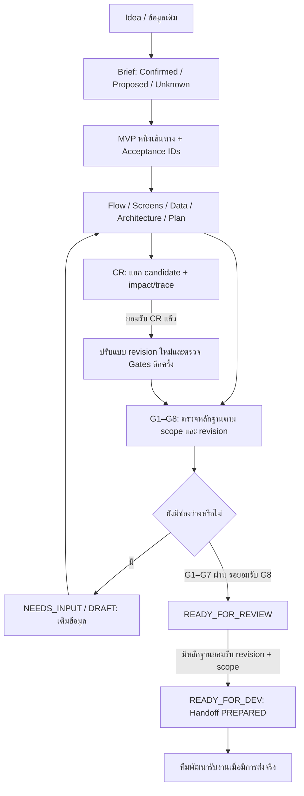

# ใช้ Project Design Advisor ออกแบบโปรเจกต์

Skill นี้ช่วยเริ่มจาก Idea และค่อย ๆ สร้างแบบที่มีหลักฐาน ก่อนแยกไป UX/UI/Code
รวมการตรวจความพร้อม G1–G8, เตรียม Dev Handoff และวิเคราะห์ CR เทียบ baseline
เป็น advisor ของแบบ ไม่ใช่การอนุมัติแทนเจ้าของ Project หรือการรับรองโค้ด

## ใช้ผ่าน Skill Studio

1. เปิด Studio แล้วเลือกขั้น **ออกแบบ Project**
2. เลือกตัวอย่างตามสิ่งที่ต้องการในตารางด้านล่าง ปุ่มจะแทนที่ช่องโจทย์เท่านั้น
   เก็บชื่อโปรเจกต์ บริบทและคำตอบเดิม พร้อมเลือก Skill/เอกสารที่จำเป็น
3. แก้ข้อความในวงเล็บ แล้วใส่ข้อมูลจริงในช่องบริบท
4. ตรวจแท็บ Prompt แล้ว **คัดลอกไป Codex** หรือ **ส่งให้ LLM** ที่ตั้งค่าไว้
5. ตรวจคำตอบ เพิ่มคำตอบของคุณ/หลักฐานในบริบท แล้วเดินต่อในขั้นที่เหมาะสม

| ตัวอย่าง | ใส่อะไรในบริบท | สิ่งที่ควรได้ |
|---|---|---|
| เริ่มจาก Idea | Idea สั้น ๆ; ผู้ใช้/เหตุการณ์ที่รู้แล้ว | ถ้ายังไม่รู้ปัญหา ตอบสั้นและถามทีละหนึ่งประเด็น |
| ตรวจพร้อม Dev | แบบ/checkpoint, revision, scope, owner และหลักฐานยอมรับที่มีจริง | Gates G1–G8, evidence, gaps/blockers และ readiness ตามจริง |
| เตรียม Handoff | Baseline และ requirement/acceptance IDs พร้อมผล readiness | Prompt ตรง baseline; ถ้ายังไม่พร้อมจะเป็น DRAFT / DO NOT START IMPLEMENTATION |
| วิเคราะห์ CR | Baseline เดิม, before → after, เหตุผล/requester และหลักฐาน CR | Impact/trace, candidate แยกจาก baseline และข้อเสนอขั้นต่อไป |

Readiness/Handoff แนบ reference สำหรับ Gates และการส่งต่อ ส่วน CR แนบทั้ง
CR และ readiness reference ตรวจรายการได้ใน **เอกสารเสริม**
หากเลือกเอกสารเต็ม 8 รายการอยู่แล้ว ให้ลดรายการก่อนเลือกตัวอย่างที่ต้องเพิ่มเอกสาร

Studio เป็นพื้นที่เตรียม prompt แบบรอบต่อรอบ ไม่ใช่ระบบ memory หรือแชตที่ส่งประวัติทั้งหมด
ไป LLM อัตโนมัติ ใช้ **ใช้เป็นบริบท** เพื่อแนบผลก่อนหน้า แล้วเติมคำตอบ/ข้อแก้ไขของคุณ
เช่น หลังตอบคำถามรอบแรก ให้เปลี่ยนโจทย์เป็น “ร่าง Project Brief จากข้อเท็จจริงในบริบท
แยก Proposed/Unknown และยังไม่ถือว่าอนุมัติแบบ” คำตอบที่มีเพียงข้อเสนอไม่ใช่ accepted decision

## ใช้โดยตรงใน Codex

เปิดแชตใน Repo นี้แล้วใช้:

```text
ใช้ $project-design-advisor
Idea ของฉันคือ [อธิบาย Idea]
ช่วยเริ่มจากทำความเข้าใจผู้ใช้และปัญหาจริง ถามครั้งละหนึ่งประเด็น
```

ถ้าพร้อมให้ร่าง:

```text
ใช้ $project-design-advisor ร่าง Project Brief, MVP และ User Flow
จากข้อมูลที่แนบ แยก Confirmed / Proposed / Unknown
ข้อเสนอเรื่อง stack/auth/hosting ยังไม่ใช่ข้อตกลงของฉัน
```

ถ้าต้องตรวจพร้อม Dev:

```text
ใช้ $project-design-advisor ประเมินแบบที่แนบ
Project: [ชื่อ] / baseline: [revision จริง] / scope: [slice]
ตรวจ G1–G8 และ acceptance IDs พร้อม evidence/section@revision
ถ้าหลักฐานยังไม่ครบ ให้ระบุ blocker และอย่าสร้าง approval ย้อนหลัง
```

ตัวชี้ native และชื่อ **AIDE Project Design Advisor** สร้างใน `.agents/skills/`
หากแชตเก่าไม่เห็น ให้เริ่มแชตใหม่ หรือให้อ่านต้นฉบับโดย path:
`skills/ux/project-design-advisor/SKILL.md` การทดสอบตัวชี้ไม่ใช่หลักฐานว่า
native picker หรือพฤติกรรม LLM ทุกกรณีผ่านแล้ว

## Flow และชุดชิ้นงาน



เมื่อขอชุดส่งต่อ อาจได้ PRODUCT, PRD, DESIGN, ARCHITECTURE, PLAN และ
PROJECT-CHECKPOINT ตาม scope เพิ่ม READINESS-REPORT / DEV-HANDOFF-PROMPT /
CR-ANALYSIS / DEV-DELTA-PROMPT เฉพาะช่วงที่เกี่ยวข้อง
`accepted_decisions=[]` จนมีหลักฐานตอบรับชัดเจน และ G8 ไม่ใช้ N/A

ไม่มี memory service ให้ checkpoint พร้อมคัดลอก ไม่อ้าง “จำข้ามแชตแล้ว”
การเตรียม Prompt คือ PREPARED; SENT/ACKNOWLEDGED/DEV_STARTED ต้องมีหลักฐานแยก
แบบที่ยังไม่พร้อมต้องใช้ DRAFT / DO NOT START IMPLEMENTATION

## ขอบเขตต้นทางและการตรวจ

อ้างอิงต้นทางตามข้อความที่ผู้ใช้ให้ และรักษา attribution ของ Task Observer/CC BY 4.0
ไม่มีการติดตั้ง Find Skills, Superpowers, claude-mem หรือ runtime อื่นจากการเพิ่ม Skill นี้
ไม่มี `sources.lock.json` ของชุดติดตั้งเดิม จึงไม่อ้างว่าได้ตรวจ upstream revisions
ดู [provenance](../skills/ux/project-design-advisor/references/source-provenance.md)
และ [ต้นฉบับ Skill](../skills/ux/project-design-advisor/SKILL.md)

การตรวจ integration ครอบคลุมการค้นพบใน catalog, starter → prompt/reference,
workspace เดิมและแพ็ก release พฤติกรรมการตอบจริงของโมเดลยังต้องประเมินกับ
โจทย์/แบบ/approval evidence ที่มีจริง ไม่ใช้ข้อความจาก fixture เป็นผลประเมิน Skill
