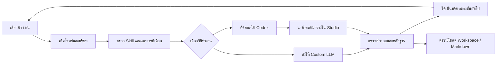

# Skill Studio: คู่มือใช้งาน

Skill Studio 1.2.0 เป็น App ภาษาไทยที่เปิดในเบราว์เซอร์ของเครื่องคุณ
รวม 11 Core Skills และ 2 Community Skills จาก canonical source ของ Repo
เลือกช่วงงาน เตรียม prompt และเชื่อมต่อ Custom LLM ได้โดยไม่ต้องค้นหาไฟล์เอง

## เปิดใช้งาน

**Windows x64:** แตกไฟล์ `aide-skill-studio-1.2.0-windows-x64.zip` ทั้งหมด
แล้วดับเบิลคลิก `Start Studio.cmd` มี Node รวมมาแล้ว ไม่ต้องลง npm
เปิดค้างหน้าต่างโปรแกรมไว้ระหว่างใช้งาน ปิดหน้าต่างนั้นเพื่อหยุดเซิร์ฟเวอร์

**macOS / Linux / Windows ที่มี Node:** ใช้ ZIP ที่ลงท้าย `-node.zip`
ต้องมี Node >=22.12.0 แนะนำ Node 24 LTS รุ่นที่อัปเดตแล้ว
Windows เปิด `Start Studio.cmd`; macOS/Linux ใช้ `sh start-studio.sh`
แพ็กนี้ยังไม่ได้ทดสอบเปิดจริงบน macOS/Linux

**จาก Source:** รันจาก root ของ Repo

```bash
npm ci
npm ci --prefix apps/studio
npm run studio:build
npm run studio
```

App เปิดที่ `http://127.0.0.1:4318` หากพอร์ตถูกใช้ จะเลือกพอร์ตว่างและแสดง URL
ในหน้าต่างโปรแกรม ใช้ `npm run studio:serve` เพื่อเปิดเซิร์ฟเวอร์อย่างเดียว
หรือ `node apps/studio/server/start.mjs --port=4325` เพื่อระบุพอร์ตเอง

## Flow หลัก



1. เลือก **เริ่มต้น / ออกแบบ Project / วาง UX / ออกแบบ UI / เขียนโค้ด / ตรวจคุณภาพ / ปรับปรุง**
   App จะเลือก Skill ที่เหมาะสม สามารถเพิ่มหรือนำออกเองได้
2. ใส่ชื่อโปรเจกต์ สิ่งที่ต้องการ และบริบท เช่น ผู้ใช้ Stack แบรนด์ หรือ Spec
3. เปิด **Skill ที่ใช้ในงานนี้** และ **เอกสารเสริม** เพื่อตรวจสิ่งที่จะรวมใน prompt
   การเปลี่ยนช่วงงานจะเปลี่ยน Skill และล้างรายการเอกสารเสริม โดยคงโจทย์/บริบทไว้
4. อ่านแท็บ **Prompt** แล้วเลือกคัดลอกไป Codex หรือส่งให้ LLM
5. อ่าน **ผลลัพธ์** และตรวจข้อเสนอในโปรเจกต์จริง ก่อนใช้เป็นบริบทขั้นถัดไป

## ใช้กับ Codex UI

สำหรับ Idea ใหม่ เริ่มที่ **ออกแบบ Project** แล้วเลือกตัวอย่าง
**เริ่มจาก Idea / ตรวจพร้อม Dev / เตรียม Handoff / วิเคราะห์ CR**
ปุ่มจะเปลี่ยนช่องโจทย์และเลือกเอกสารที่จำเป็น โดยเก็บบริบท/คำตอบไว้
แก้ข้อความในวงเล็บและแนบแบบ/checkpoint ในบริบทก่อนส่ง
ดู [คู่มือ Project Design Advisor](project-design-advisor-guide.md)

กด **คัดลอกไป Codex** แล้ววางในแชตของโปรเจกต์ปลายทาง
prompt มีเนื้อหา Skill ที่เลือกอยู่แล้ว จึงใช้ได้แม้โปรเจกต์นั้นยังไม่ได้ติดตั้ง Skill
หากต้องการให้ Codex อ่านหรือแก้ไฟล์ ต้องเปิดแชตที่มีสิทธิ์เข้าถึงโปรเจกต์นั้น
Studio ไม่ส่งข้อความเข้าแชตและไม่แก้ไฟล์แทนโดยอัตโนมัติ

คัดลอกคำตอบจาก Codex กลับมาที่ **ผลลัพธ์ → วางผลลัพธ์จาก Codex หรือแชตอื่น**
แล้วกดบันทึก ใช้ **ใช้เป็นบริบท** เมื่อต้องการต่อยอดในขั้นถัดไป
วิธีเรียก Skill แบบ native ด้วย `$ชื่อ-skill` ดู [Codex UI guide](codex-ui-guide.md)

## เชื่อม Custom LLM

เปิด **Custom LLM** แล้วกรอก Base URL, Protocol และชื่อ Model ตาม provider
ใส่ API key เมื่อ provider ต้องใช้ กด **บันทึกการเชื่อมต่อ**
หรือ **บันทึกและโหลดโมเดล** เพื่อเรียก `/models` แล้วเลือกชื่อ Model
การบันทึกอย่างเดียวไม่ยืนยันว่า provider พร้อมใช้

| Provider | Base URL ตัวอย่าง | Protocol |
|---|---|---|
| Ollama ในเครื่อง | `http://127.0.0.1:11434/v1` | Chat Completions |
| LM Studio ในเครื่อง | `http://127.0.0.1:1234/v1` | Chat Completions |
| Custom / Gateway | URL ที่ provider กำหนด เช่น `https://llm.example.com/v1` | ตาม API ที่รองรับ |
| OpenAI | `https://api.openai.com/v1` | Responses หรือ Chat Completions |

Preset เป็นค่าเริ่มต้นที่แก้ไขได้ ต้องเปิด provider และโหลดโมเดลตามคู่มือของ provider
Base URL ไม่รวม `/chat/completions` หรือ `/responses` และไม่มี key ใน URL
รองรับ Bearer token; provider ที่บังคับ header เฉพาะหรือ API คนละรูปแบบต้องใช้ gateway
ชื่อ Model ต้องตรงกับปลายทาง ไม่มีการเลือกโมเดลหรือสมัครบริการให้เอง

กลับไปเวิร์กโฟลว์แล้วกด **ส่งให้ LLM** App จะส่งโจทย์ บริบท Skill และเอกสารที่เลือก
ไปยัง URL นั้น ใช้ Timeout 1–600 วินาทีและยกเลิกระหว่างรอได้
คำตอบจะแสดงเมื่อส่งครบ ไม่มี token streaming หรือการเรียก tools ของโมเดล

## ข้อมูลและข้อจำกัด

- Workspace บันทึกในเบราว์เซอร์ที่ URL/พอร์ตนั้นแบบ best effort
  เปลี่ยนเบราว์เซอร์ พอร์ต หรือเคลียร์ข้อมูลแล้วอาจไม่เห็นงานเดิม จึงควรดาวน์โหลดสำรอง
- **เก็บ workspace** ส่งออก JSON; **นำเข้า** เปิดไฟล์เดิมได้
  ไม่มีการตั้งค่า provider หรือ API key ในไฟล์ส่งออก
- เก็บประวัติล่าสุดไม่เกิน 20 คำตอบ และรวม Workspace ไม่เกิน 3 MB
  เมื่อเพิ่มคำตอบหรือบริบทจนเต็ม คำตอบเก่าสุดจะถูกนำออกก่อน ควรดาวน์โหลดคำตอบสำคัญเป็น Markdown
- ข้อจำกัดตัวอักษร: โจทย์ 16,000, บริบท 40,000, prompt รวม 300,000,
  คำตอบละ 500,000; ขนาด context ที่โมเดลรับจริงขึ้นอยู่กับ provider
- API key อยู่ในหน่วยความจำของเซิร์ฟเวอร์เท่านั้น ปิดโปรแกรมแล้วต้องกรอกใหม่
  การเปลี่ยน Base URL จะไม่นำ key ของปลายทางเดิมติดไปด้วย
- ไม่ใส่ secret ในโจทย์หรือบริบท เพราะส่วนนั้นอาจถูกส่งไป LLM และอยู่ในไฟล์สำรอง
- App ฟังเฉพาะ loopback และออกแบบสำหรับคนเดียวในเครื่อง
  ไม่ควรเปิดผ่าน reverse proxy เป็นบริการสาธารณะ
- Studio รับข้อความจากโมเดล ไม่มี tools สำหรับรันคำสั่งหรือแก้โปรเจกต์
  คำตอบของ LLM ไม่ใช่หลักฐานว่ามีการทดสอบหรือผ่าน review แล้ว

## เมื่อมีปัญหา

| อาการ | วิธีแก้ |
|---|---|
| เปิด App แล้วพบหน้าให้ build | ติดตั้ง dependencies ทั้ง root และ `apps/studio` แล้ว build |
| โหลดโมเดลไม่ได้ แต่รู้ชื่อ Model | กรอกชื่อเองแล้วบันทึก บาง provider ไม่มี `/models` |
| Provider ตอบ 401/403 | ตรวจสิทธิ์และ key ของ provider แล้วบันทึกใหม่ |
| Provider ตอบ 404 | ตรวจ Base URL และ Protocol |
| Timeout / network error | ตรวจว่า server/model เปิดอยู่ เพิ่ม Timeout หรือแบ่งงาน |
| prompt ใหญ่เกิน | ลด Skill/เอกสาร/บริบทที่เลือก หรือแบ่งขั้นตอน |
| นำเข้าไม่ได้ | ใช้ JSON ของ Studio เวอร์ชัน 1 ไม่เกิน 3 MB; ไฟล์เดิมยังไม่ถูกแทนที่เมื่ออ่านล้มเหลว |

ดูผลตรวจจริงและขอบเขตที่ยังไม่ตรวจใน [Studio validation](studio-validation.md)
และขั้นตอนแพ็ก/Release ใน [Release notes 1.2.0](releases/v1.2.0.md)
